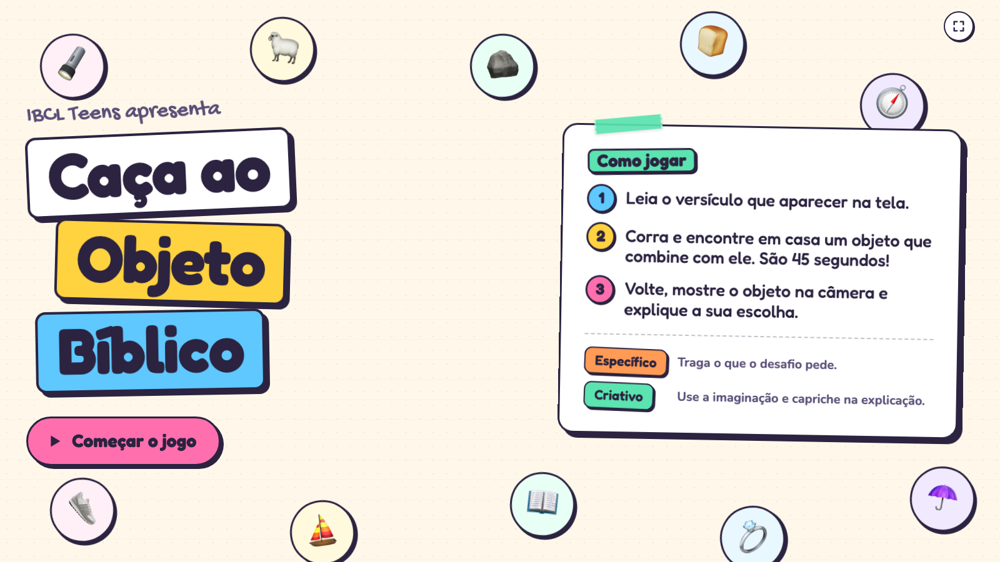
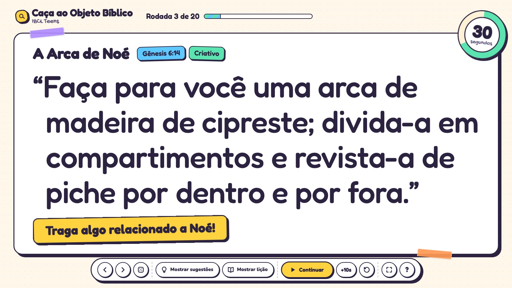
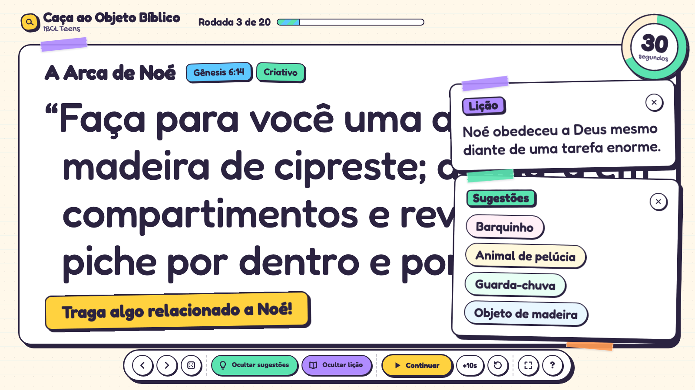
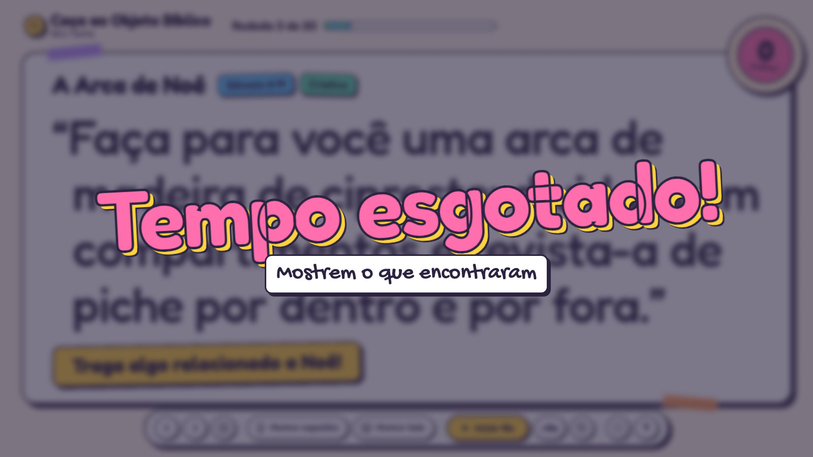

# 🔍 Caça ao Objeto Bíblico

**A Bible verse scavenger hunt for IBCL Teens, made to be screen-shared on a video call.**

The host puts a verse on screen. Everyone has 45 seconds to run around the house and grab an object that matches it, then comes back to the camera to show it off and explain the pick.



It's a single HTML file. There's nothing to install or build: open it in a browser, share the tab, and play.

---

## How to play

1. **Read the verse** that appears on screen. The yellow banner under it is the round's challenge, like *"Traga algo relacionado a Noé!"*
2. **Run.** When the host starts the timer, you have **45 seconds** to find an object at home that fits the verse and the challenge.
3. **Show and explain.** Back on camera, hold up your object and say why you picked it.

Each round has a tag that tells you what counts:

| Tag | What it means |
|---|---|
| **Específico** | Bring what the challenge asks for. A lantern for *"Traga algo que produza luz!"* |
| **Criativo** | Use your imagination. Almost anything works if you can explain the link well. |

> 💡 **Host tip:** let each player justify their object. In the *Criativo* rounds, the explanation is worth more than the object itself.

There are **20 rounds**, covering stories like Davi e Golias, a Arca de Noé, Jonas, o Filho Pródigo, Pedro sobre as águas and more. Each one comes with suggestions and a short lesson you can reveal once the hunt is over.



---

## Hosting a game

### Before the call

1. Download [`preview.html`](preview.html), or clone the repo.
2. Open it in **Chrome**.
3. In the call, share the game's **tab** rather than your whole screen. Sharing a tab lets you send its audio too, so players hear the timer beeps.
4. Press **F** for fullscreen.

### During the game

1. On the title screen, press **Começar o jogo** (or Enter).
2. Read the verse and challenge aloud, then press **Iniciar 45s** (or Space).
3. Need more time? Press **+10s** whenever you like, even after time's up.
4. When **Tempo esgotado!** appears, everyone shows their object.
5. Reveal ideas with **Mostrar sugestões** and the takeaway with **Mostrar lição**.
6. Go to the next round with **→**, or press **🎲** to draw a round that hasn't been played yet.

<p>
  
  
</p>

### Controls

Every button in the bottom bar has a keyboard shortcut, so you can run the whole game from the keyboard while you talk.

| Button | Key | What it does |
|---|:---:|---|
| ‹ › | ← → | Previous / next round |
| 🎲 | A | Draw a random round that hasn't been played yet |
| Mostrar sugestões | S | Show or hide object ideas for the round |
| Mostrar lição | L | Show or hide the round's lesson |
| Iniciar / Pausar / Continuar | Space | Start, pause or resume the timer |
| +10s | + | Add 10 seconds. After time's up, starts a fresh 10-second countdown |
| ↺ | R | Reset the timer to 45 seconds |
| ⛶ | F | Toggle fullscreen |
| ? | ? | Show all shortcuts |
| Logo (top left) | T | Back to the title screen. Pauses the timer |
| | Esc | Close any open notes |

---

## Making it yours

All the content lives in the `rounds` list near the bottom of [`preview.html`](preview.html). Each round looks like this:

```js
{
  title: "A Luz do Mundo",
  reference: "Mateus 5:14-16",
  type: "Específico",            // or "Criativo"
  verse: "Vocês são a luz do mundo. Não se pode esconder uma cidade construída sobre um monte.",
  challenge: "Traga algo que produza luz!",
  suggestions: ["Lanterna", "Luminária", "Vela", "Celular"],
  lesson: "Nossa vida deve refletir a luz de Cristo."
}
```

Add, remove or reorder rounds freely. The round counter, progress bar and random draw adjust on their own. The verse is resized to fill the screen, so short and long verses both fit.

To change the timing, edit the two constants just below the list:

```js
const TIME = 45, BONUS = 10;   // seconds per round, seconds added by +10s
```

---

## Design notes

- **Built for streaming.** The verse fills the screen and is resized to stay readable through video compression. The host controls float in a bar at the bottom, and the timer stays pinned to the corner so viewers can always see it.
- **Scrapbook look.** It uses the same visual style as *Louvor Karaokê*: notebook-paper background, sticker cards with ink borders and hard shadows, washi tape, and the Fredoka, Gochi Hand and Nunito fonts.
- **No dependencies.** It's plain HTML, CSS and JavaScript in one file. The only network request is for Google Fonts, with system fonts as a fallback.
- **Respects reduced motion.** If the operating system asks for less motion, the animations are turned off.

Made with ❤️ for IBCL Teens.
